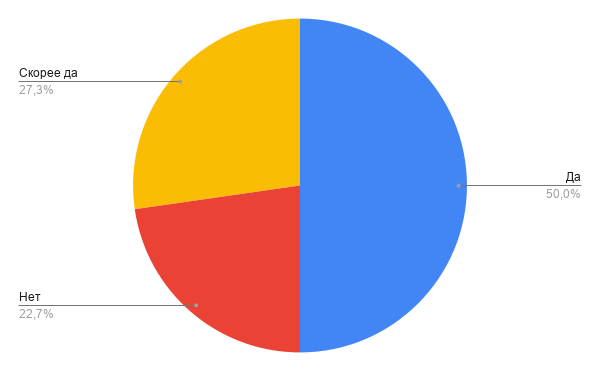
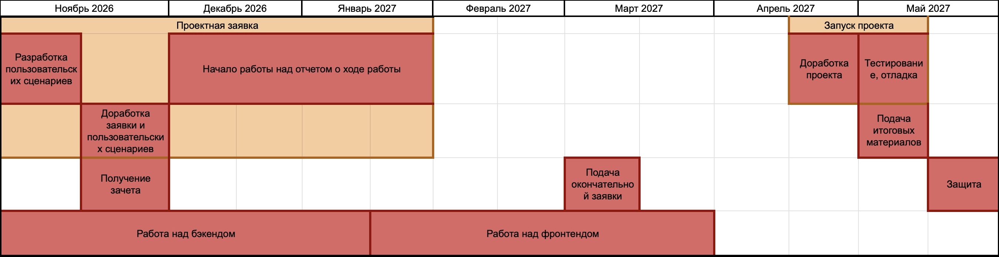

# Путяков Станислав - "Сервис для публикации и просмотра кулинарных рецептов"
## Куратор: Шалаева Анастасия Владимировна
## Группа 10И4
## Электронная почта: skputyakov@edu.hse.ru
## Tg: @s1tas1

### **[ НАЗВАНИЕ ПРОЕКТА ]**

"Сервис для публикации и просмтра кулинарных рецептов"

### **[ ПРОБЛЕМНОЕ ПОЛЕ ]**

При нахождении кулинарных рецептов люди, следящие за питанием, не могут сразу узнать КБЖУ для получившейся порции. **Трудности**: Отсутствие для некоторых рецептов расчета КБЖУ; Небходимость при изменении рецепта (уменьшение или увеличение кол-ва того или иного ингридиента) вручную пересчитывать КБЖУ. Среди опрошенных людей, которые ищут рецепты **чаще**, чем раз в месяц (88 человек): 50% отметили, что для них функция расчёта КБЖУ будет полезна; 23% отметили, что для них данная функция будет не важна; а 27% не смогли дать утвердительный или отрицательный ответ.

### **[ ЦЕЛЕВАЯ АУДИТОРИЯ ]**

+ Люди, следящие за питанием
+ Люди, котрые хотят поделится своими кулинарными рецептами
+ Люди, ищущие кулинарные рецепты

### **[ АППАРАТНЫЕ / ПРОГРАММНЫЕ ТРЕБОВАНИЯ ]**

+ Устройство с экраном более чем 375x667 пикселей
+ Браузер: Firefox, Chrome

### **[ ФУНКЦИОНАЛЬНЫЕ ТРЕБОВАНИЯ ]**

Программный продукт будет предоставлять следующие возможности:

1. Авторизация и другие действия с аккаунтами
2. Публикация рецептов
3. Просмтр рецептов
4. Автоматический расчет КБЖУ на 100 гр
5. Автоматический расчет необходимых продуктов для нужного кол-ва порций
6. Возможность оценки рецептов
7. Возможность оставлять комментарии
8. Поиск по тегам (например "высокое содержание белка" или "выпечка"
9. Поиск доступных рецептов по наличию ингредиентов
10. Создание PDF версий рецепта 

### **[ ПОХОЖИЕ / АНАЛОГИЧНЫЕ ПРОДУКТЫ ]**

Анализ 3 сервисов, которые максимально приближены к заданному функционалу, показал, что:

* russianfood.com - отсутствует расчет КБЖУ
* gastronom.ru - отсутствует возможность изменить размер порции
* Кулинарные блоги на разных сайтах для публикаций (Дзен, ВК и др.) - отсутствие возможности сохранить рецепт как PDF файл

### **[ ИНСТРУМЕНТЫ РАЗРАБОТКИ, ИНФОРМАЦИЯ О БД ]**

* Бэкенд - kotlin или node.js/Express.js (пока не выбрал)
* Фронтенд - HTML/CSS/JS/React
* База данных - PostgreSQL
* Система контроля версий Git/Github

### **[ ЭТАПЫ РАЗРАБОТКИ ]**

* Проектная заявка (01.11.2026-29.01.2027)
* * Разработка пользовательских сценариев (01.11.2026-14.11.2026)
* * Доработка заявки и пользовательских сценариев (14.11.2026-27.11.2026)
* * Начало работы над отчетом о ходе работы (01.12.2026-29.01.2027)
* Получение зачета (27.11.2026-30.11.2026)
* Работа над бэкендом (06.11.2026-15.01.2027)
* Работа над фронтендом (15.01.2027-26.02.2027)
* Подача окончательной заявки (01.03.2027-15.03.2027)
* Запуск проекта (16.04.2027-07.05.2027)
* * Доработка проекта (16.04.2027-23.04.2027)
* * Тестирование, отладка (23.04.2027-07.05.2027)
* Подача итоговых материалов (07.05.2027-14.05.2027)
* Защита (29.05.2027-30.05.2027)

### **[ ВОЗМОЖНЫЕ РИСКИ ]**

* Не разберусь с работой с базой данных с калорийностью продуктов
* Не хватит времени на изучение фреймворка react
* Невозможность спроектировать удобный пользовательский интерфейс